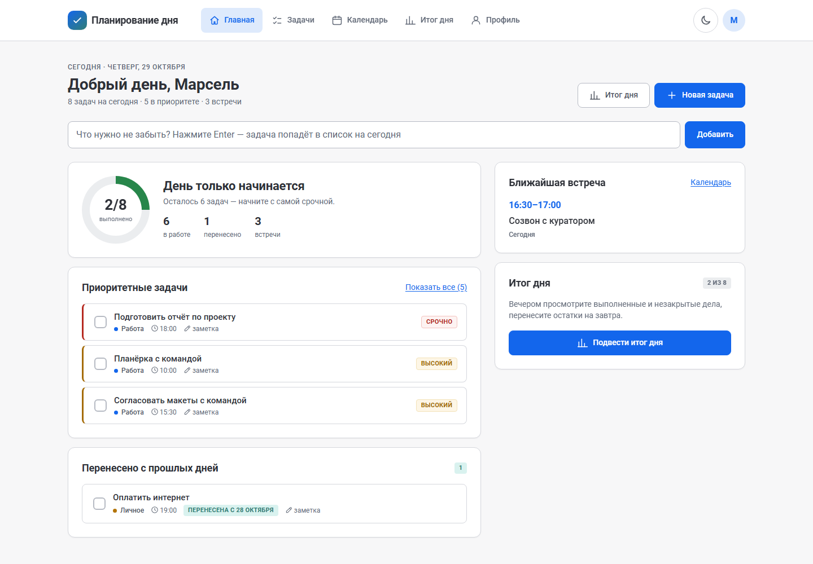
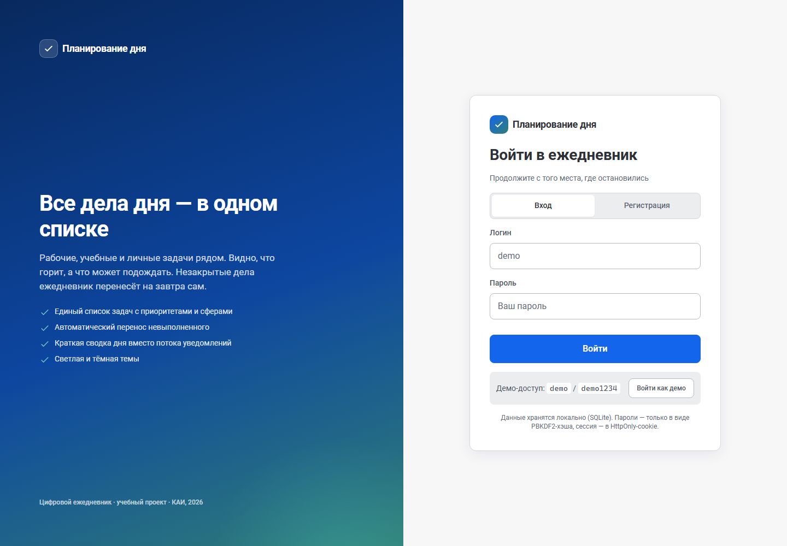
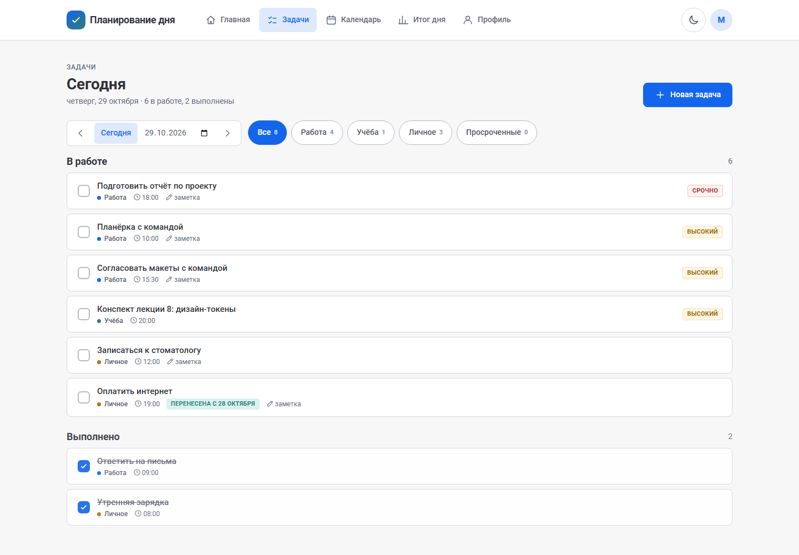
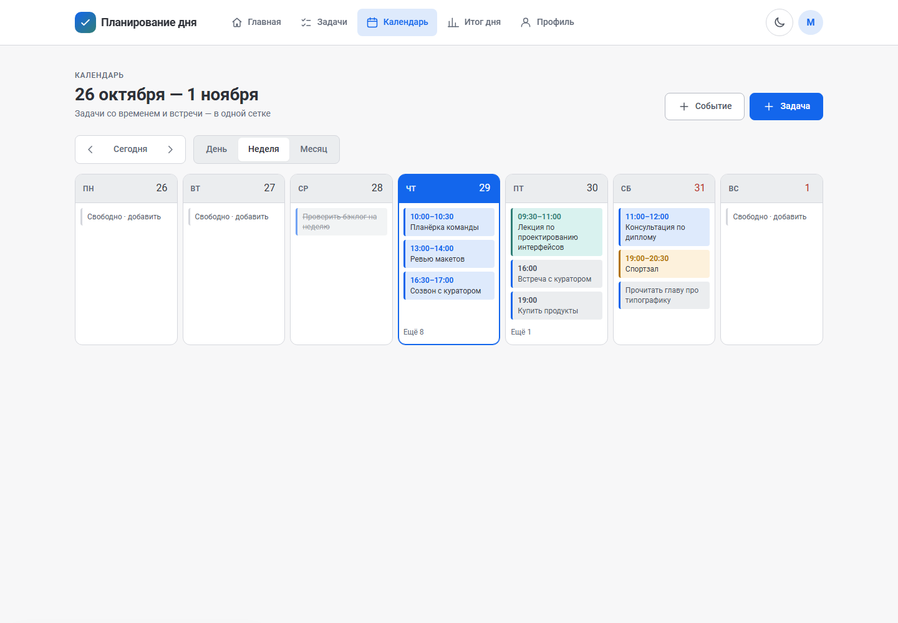
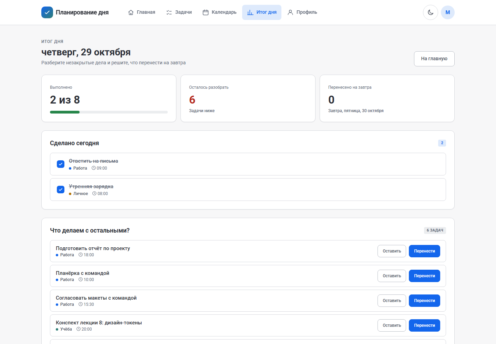
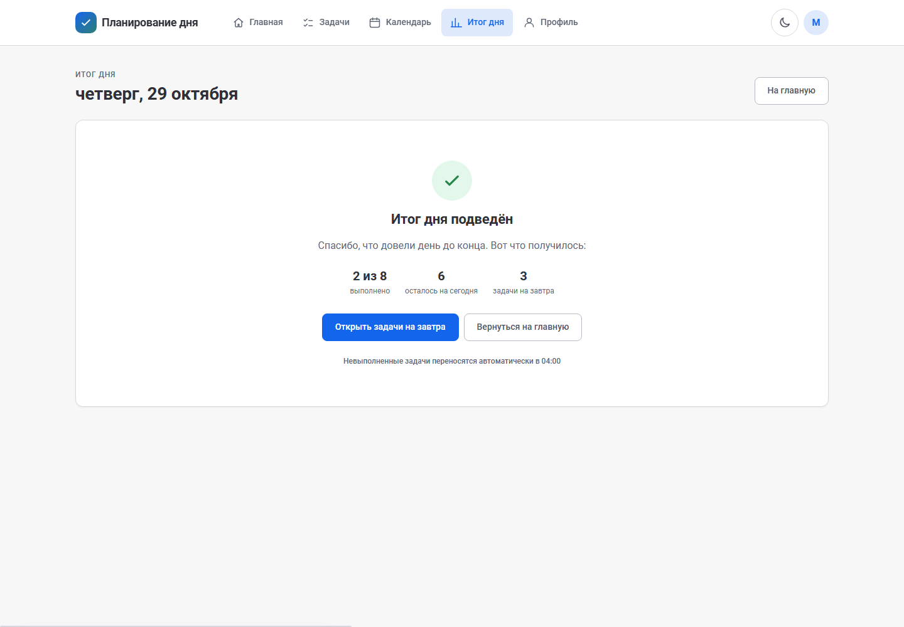
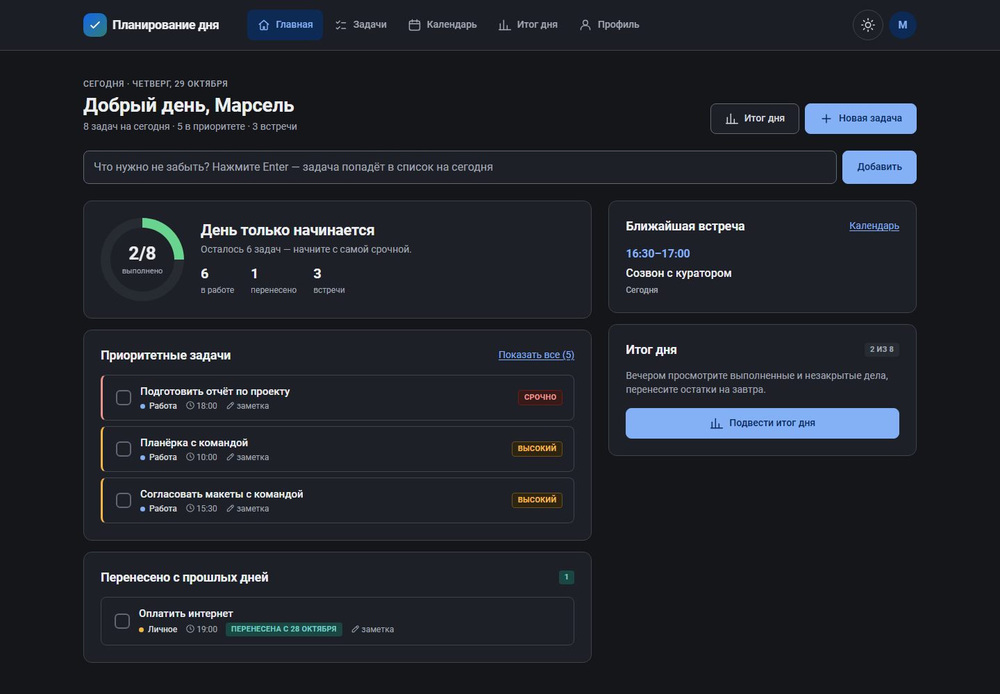
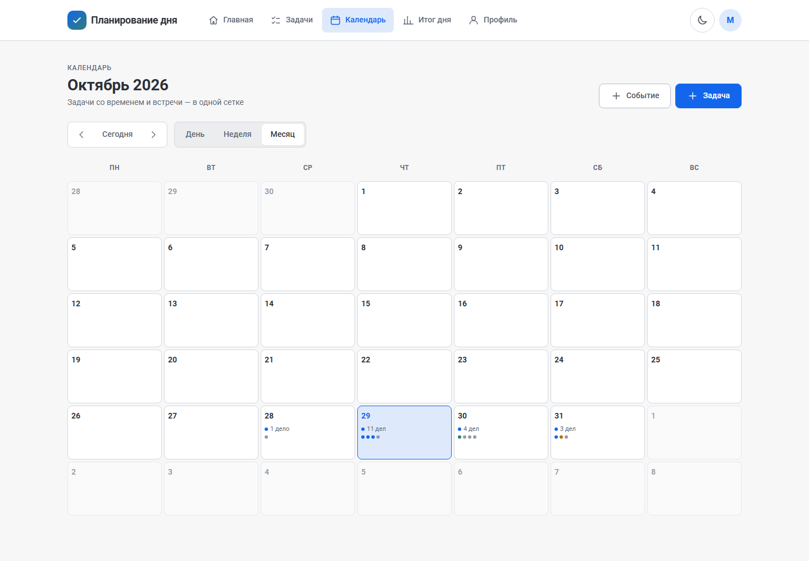
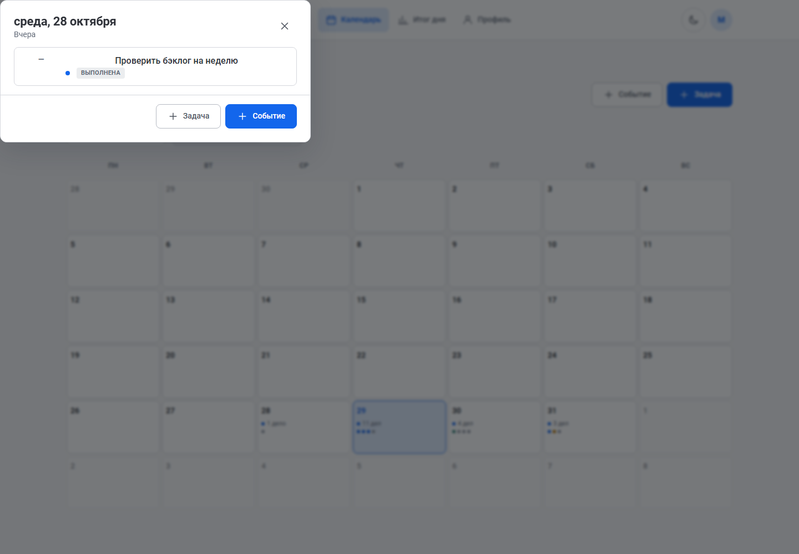
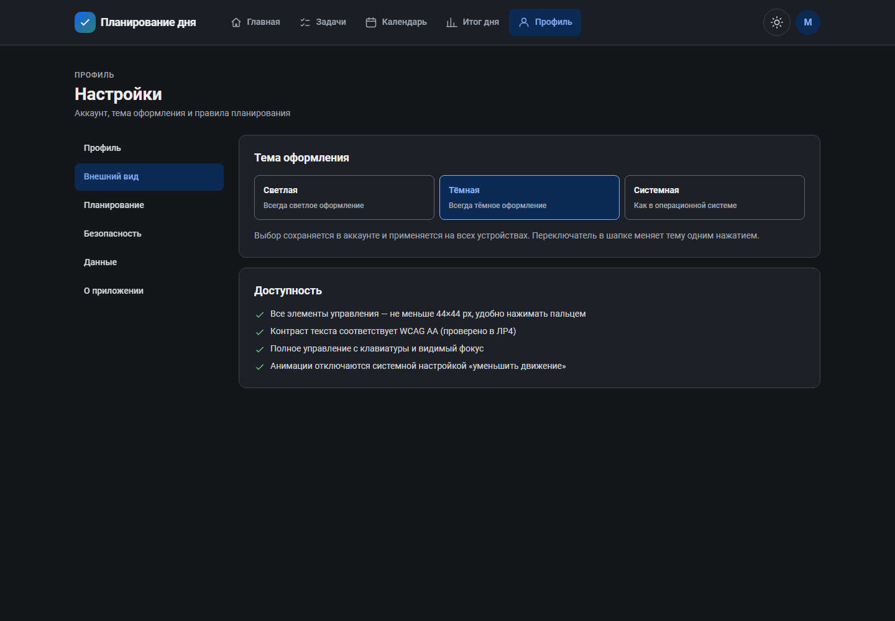

# Планирование дня — цифровой ежедневник

Полноценное веб-приложение для планирования дня: единый список задач, приоритеты,
сферы жизни, календарь встреч, сводка и итоги дня, автоматический перенос
невыполненных дел на следующий день. Светлая и тёмная темы, адаптивный интерфейс
для компьютера и телефона.

Проект собран по материалам лабораторных работ: UX-исследование и персоны,
вайрфреймы, UI-кит, hi-fi прототип, тёмная тема, юзабилити-тестирование и его
правки. Это не макет, а работающее приложение с базой данных, аккаунтами и
настоящими сценариями.

**Живая версия:** <https://daily-planner-ha2a.onrender.com/> — бесплатный тариф
Render, поэтому первый заход после простоя может занять до минуты.



## Быстрый старт

Нужен только Python 3.10+. Никаких зависимостей, пакетов и сборки.

```bash
python run.py
```

Windows — двойной щелчок по `start.cmd` (или `.\start.ps1`), он сам откроет браузер.

Приложение поднимется на <http://127.0.0.1:8000/>. При первом запуске создаётся
демонстрационный аккаунт с данными на сегодня, вчера и завтра:

* логин: `demo`
* пароль: `demo1234`

Полезные ключи:

```bash
python run.py --port 9000     # другой порт
python run.py --open          # сразу открыть браузер
python run.py --reset         # удалить базу и начать с чистого листа
```

## Публикация в интернете

Приложение можно открыть с телефона по постоянной HTTPS-ссылке: GitHub хранит
код и запускает тесты, Render раздаёт Python-сервер, Neon даёт PostgreSQL.
Все три сервиса бесплатны, а `git push` сразу обновляет сайт.

Полная пошаговая инструкция — [docs/deploy.md](docs/deploy.md). Коротко:

```bash
git init && git add . && git commit -m "Ежедневник"
git branch -M main
git remote add origin https://github.com/ЛОГИН/daily-planner.git
git push -u origin main
```

Дальше: создать проект в Neon, нажать в Render «New → Blueprint», выбрать
репозиторий и вставить строку подключения к базе. Всё остальное описано в
`render.yaml` — сервис, health check, автодеплой и переменные окружения.

## Что умеет

**Задачи и день**

* единый список задач на выбранный день, переход по дням и календарь в поле даты;
* быстрые действия: приоритет, сфера, время, заметка, срок;
* быстрое добавление с главной одной строкой (Enter);
* отметка выполнения с возможностью отменить действие из уведомления;
* редактирование и удаление задачи (удаление — с отменой);
* фильтры по сферам и отдельный список просроченных задач.

**Приоритеты и сводка**

* четыре уровня приоритета, визуальное выделение срочного и важного;
* сводка дня на главной: прогресс, приоритетные задачи, ближайшая встреча,
  просроченные дела, количество перенесённых задач;
* «перенесена» — отдельная метка с датой, откуда пришла задача.

**Перенос невыполненного**

* фоновый планировщик и ленивая проверка при запросах переносят незакрытые
  задачи на текущий день, сохраняя приоритет и сферу;
* время переноса настраивается в профиле (по умолчанию 04:00);
* перенос можно запустить вручную из профиля;
* на экране «Итог дня» — перенос по одной задаче с отменой, «оставить на сегодня»
  и массовый перенос.

**Календарь**

* виды «День», «Неделя», «Месяц»;
* события со временем и задачи в одной сетке, с разными цветами;
* клик по дню открывает список дел, оттуда можно добавить задачу или событие;
* количество дел в месяце считается из тех же данных, что и в неделе.

**Аккаунт и настройки**

* регистрация и вход по логину и паролю, сессии в HttpOnly-cookie;
* смена пароля, удаление аккаунта, выход;
* тема: светлая, тёмная или как в системе; переключатель в шапке;
* настройки планирования, экспорт задач и событий в JSON;
* адаптивный интерфейс: на телефоне — нижняя навигация, кнопка «+» и одноколоночные экраны.

## Экраны

| Вход | Задачи | Календарь |
| --- | --- | --- |
|  |  |  |

| Итог дня | Финальный экран | Тёмная тема |
| --- | --- | --- |
|  |  |  |

| Месяц | День в календаре | Профиль |
| --- | --- | --- |
|  |  |  |

Мобильная версия: [главная](docs/screenshots/15-mobile-home.png),
[задачи](docs/screenshots/16-mobile-tasks.png),
[календарь](docs/screenshots/17-mobile-calendar.png),
[итог дня](docs/screenshots/18-mobile-review.png),
[форма задачи](docs/screenshots/19-mobile-task-form.png).

## Технологии

| Слой | Решение | Почему |
| --- | --- | --- |
| Сервер | Python 3: стандартная библиотека локально, WSGI + gunicorn в продакшене | одна кодовая база для `python run.py` и хостинга |
| База | SQLite локально, PostgreSQL на сервере — один слой данных | разработка без установки БД, продакшен с постоянным хранением |
| API | REST + JSON, сессии в HttpOnly-cookie | простые контракты, легко проверить curl-ом |
| Клиент | нативный JavaScript (ES-модули), один CSS с дизайн-токенами | нет сборки и зависимостей, при этом код разделён по слоям |
| Иконки | собственный SVG-спрайт | без внешних библиотек и шрифтов |
| Деплой | GitHub → Render (сервис) + Neon (PostgreSQL), автодеплой по push | бесплатно и без ручных выкладок |

## Структура проекта

```
digital-planner/
├── run.py                  локальный запуск (http.server)
├── app_wsgi.py             WSGI-вход для gunicorn и хостинга
├── start.cmd / start.ps1   запуск на Windows
├── requirements.txt        продакшн-зависимости: gunicorn, psycopg
├── render.yaml             инфраструктура Render: сервис, health check, автодеплой
├── server/
│   ├── app.py              локальный HTTP-сервер
│   ├── wsgi.py             WSGI-приложение (продакшен) и локальный WSGI-сервер
│   ├── api.py              маршруты REST API
│   ├── planner.py          предметная логика: задачи, перенос, сводка, итоги
│   ├── db.py               схема и адаптер SQLite/PostgreSQL
│   ├── scheduler.py        фоновый перенос задач
│   ├── static.py           статика, SPA-маршруты, заголовки безопасности
│   ├── settings.py         флаги из переменных окружения
│   ├── auth.py             пароли (PBKDF2) и сессии
│   ├── seed.py             демо-данные
│   └── errors.py           ошибки API
├── web/
│   ├── index.html
│   ├── css/tokens.css      дизайн-токены: палитра, типографика, отступы, темы
│   ├── css/app.css         компоненты и адаптивность
│   └── js/
│       ├── app.js          каркас, маршруты, темы, горячие клавиши
│       ├── api.js          клиент API
│       ├── ui.js           тосты, модальные окна, подтверждения
│       ├── task-dialogs.js форма и карточка задачи
│       ├── event-dialog.js форма события
│       ├── components.js   строки задач, бейджи, состояния
│       └── views/          главная, задачи, календарь, итог дня, профиль
├── tests/
│   ├── test_api.py         31 интеграционный тест API
│   └── test_wsgi.py        10 тестов WSGI-входа (как на хостинге)
├── tools/
│   ├── cdp.py              мини-клиент DevTools Protocol
│   └── ui_check.py         40 проверок интерфейса в реальном Chrome
├── .github/workflows/
│   ├── ci.yml              тесты на SQLite и PostgreSQL + интерфейс
│   └── keepalive.yml       пинг бесплатного Render
└── docs/
    ├── architecture.md     как устроено внутри
    ├── deploy.md           публикация: GitHub + Render + Neon
    ├── api.md              описание методов API
    └── screenshots/        скриншоты для отчёта
```

## Тесты

```bash
# 41 тест: API (регистрация, права доступа, CRUD, перенос, сводка, календарь)
# и WSGI-вход, который работает на хостинге
python -m unittest discover -s tests -v

# То же против настоящего PostgreSQL
set DATABASE_URL=postgresql://...            # Windows
PLANNER_TEST_DATABASE_URL=postgresql://... python -m unittest discover -s tests -v

# Интерфейс: 40 проверок в headless Chrome + скриншоты (нужен Chrome/Edge)
python tools/ui_check.py --out screenshots
```

`ui_check.py` сам поднимает сервер на временной базе, входит в демо-аккаунт,
создаёт и удаляет задачу, проверяет перенос с отменой, календарь, темы,
мобильную вёрстку без горизонтальной прокрутки и регистрацию нового пользователя.
Скриншоты из этого прогона лежат в `screenshots/`.

Те же проверки выполняет GitHub Actions: две job с разными базами и job с
браузером — на каждый пуш.

## Соответствие лабораторным работам

| Работа | Что отражено в приложении |
| --- | --- |
| ПИРИП ЛР1 — исследование, персоны, CJM, problem statement | единый список, приоритеты, сферы, автоматический перенос, сводка вместо потока уведомлений |
| ПИРИП ЛР2 — вайрфреймы десктопа | двухколоночная главная, список задач, неделя, итоги, профиль |
| ПИРИП ЛР3 — мобильная версия | нижняя навигация из 4 пунктов, FAB, одноколоночные списки, календарь по умолчанию «День» |
| ПИРИП ЛР4 — UI-кит | токены в `tokens.css`, Roboto, шкала 4px, радиусы 4/8/12, компоненты кнопок, полей, чекбоксов, строк задач |
| ПИРИП ЛР5–6 — hi-fi и тёмная тема | светлая/тёмная темы на семантических токенах, все пять экранов |
| ПИРИП ЛР7 — юзабилити-тестирование | «Вернуть» после переноса и удаления, форма со сроком/временем/приоритетом, задачи в календаре, «+ Событие», клик по дню месяца, карточка задачи с изменением и удалением |
| ВПКС ЛР1 — требования и варианты использования | регистрация, вход, добавление/правка/удаление, выполнение, фильтры, сводка, итоги, перенос; акторы «Пользователь» и «Планировщик» |
| ВПКС ЛР2 — диаграммы поведения | состояния задачи (`open`/`overdue`/`carried`/`done`/`deleted`), жизненный цикл сводки и последовательности «добавить — просмотреть — перенести» реализованы в API и планировщике |

## Безопасность

* пароли — PBKDF2-HMAC-SHA256, 210 000 итераций, случайная соль на пользователя;
* сессия — случайный токен в HttpOnly + SameSite=Lax cookie, срок 30 дней,
  на HTTPS добавляется флаг `Secure`;
* запросы к API проверяют владельца каждой задачи и события;
* есть ограничение частоты попыток входа (30 в минуту с адреса);
* статика отдаётся с CSP, `nosniff` и защитой от обхода каталога;
* на публичном адресе демо-аккаунт выключен (`PLANNER_SEED_DEMO=0`), строка
  подключения к базе хранится только в переменных хостинга.

## Ограничения

* бесплатный Render засыпает после 15 минут простоя: первый запрос после паузы
  может занять 30–60 секунд (лечится пингом из `keepalive.yml` или платным планом);
* уведомления и интеграции с внешними календарями сознательно не реализованы —
  эти требования были отклонены в ВПКС ЛР1 (см. реестр отклонённых требований);
* экспорт — JSON; импорта нет;
* планировщик работает, пока запущен сервер (перенос догоняется при следующем запросе).

Дальше логично добавить: повторяющиеся задачи, поиск по всем дням, импорт ICS,
PWA-режим и офлайн-кэш.
